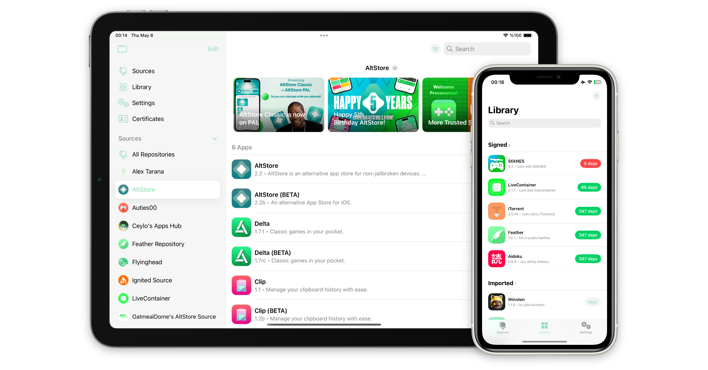

**Sign and install apps on your iPhone or iPad with your own developer certificate. No computer needed, and it updates itself.**

<picture><source media="(prefers-color-scheme: dark)" srcset="demo-dark.png"><source media="(prefers-color-scheme: light)" srcset="demo-light.png"></picture>

## Notice
**This is a fork of [Feather](https://github.com/claration/Feather) with several UX and signing improvements. I intend for this repository to receive all Feather updates, as well as any modifications I see fit.**
*__This Feather fork is under the GPL-3.0 license, and we do NOT collect any data from any user__*

## What's new in this fork

**Updates and signing**
- **In-app updates.** Quill downloads, signs and installs its own updates from Settings → Updates, then closes itself so iOS can finish.
- **Get a Certificate.** Sign in with your Apple ID or use a trusted certificate provider, one tap away in Settings when you don't have one.
- **Certificate alerts.** Warnings before a certificate expires, and an alert as soon as one is revoked.
- **Certificate Overview.** Days left, capabilities, devices and signed apps, with a revocation check.
- **Signing checks.** A warning before signing an app that's still App Store encrypted or needs a newer iOS.
- **Clearer signing errors.** Plain-language messages instead of raw error codes.
- **Signing time estimates.** The signing card shows about how long is left.
- **Smaller apps.** Optional removal of the Apple Watch app and unused languages when signing.
- **Private installs.** Fully Local uses Quill's own auto-renewing certificate, and Semi Local uses Quill's own install helper instead of a third-party one.

**Apps and sources**
- **GitHub sources.** Add a GitHub repository and install IPAs straight from its releases.
- **Better Sources.** Search apps across sources and see when each source last updated.
- **Extensions that work.** Widgets and share sheets inside apps you sign get their own signing profile.

**Progress, widgets and Live Activities**
- **Live progress.** Signing, downloads and imports show in a floating glass panel. Tap it to cancel.
- **Live Activities.** Signing, download and update progress on the Lock Screen and in the Dynamic Island.
- **Home Screen widgets.** Certificate and Library widgets in small and medium, in your accent color.
- **Offline indicator.** A small glass pill above the tab bar when you lose connection.

**Everything else**
- **Backup & Transfer.** Back up everything (or everything except apps) and restore it on another device.
- **Navigator.** Choose, hide and reorder tabs, and show or hide tab labels.
- **Developer Logs.** Export logs and crash reports, or open a pre-filled bug report on GitHub after a crash.
- **13 languages.** Including all of the screens above.

Widgets and Live Activities need a certificate that covers all app IDs.

## Features

- User-friendly and clean UI.
- Sign and install applications.
- Supports [AltStore](https://faq.altstore.io/distribute-your-apps/make-a-source#apps) repositories.
- View detailed information about apps and your certificates.
- Configurable signing options mainly for modifying the app, such as appearance and allowing support for the Files app.
  - This includes patching apps for compatibility and Liquid Glass.
- Tweak support for advanced users, using [Ellekit](https://github.com/tealbathingsuit/ellekit) for injection. 
  - Supports injecting `.deb` and `.dylib` files.
- Actively maintained: always ensuring most apps get installed properly.
- No tracking or analytics, ensuring user privacy.
- Of course, open source and free.

## Download

Visit [releases](https://github.com/NuzProjects/Feather/releases) and get the latest `.ipa`. Once installed, Feather keeps itself up to date from Settings → Updates.

## Translating

Feather now supports translation; all localizations are in `Feather/Resources/Localizable.xcstrings`

To add a new language, open Xcode and use the interface to add/contribute to languages.

To properly contribute and test potentially new localizations, you can head over to the [contributing guide](./CONTRIBUTING.md).

## Acknowledgements

- [NuzFlameV2](https://github.com/NuzProjects) - Creator of the fork
- [Samara](https://github.com/claration) - The original creator
- [idevice](https://github.com/jkcoxson/idevice) - Backend for builds with this included, used for communication with `installd`.
- [*.backloop.dev](https://backloop.dev/) - localhost with public CA signed SSL certificate
- [Vapor](https://github.com/vapor/vapor) - A server-side Swift HTTP web framework.
- [Zsign](https://github.com/zhlynn/zsign) - Allows signing on-device, re-implemented to work on other platforms such as iOS.
- [LiveContainer](https://github.com/LiveContainer/LiveContainer) - Fixes/some help
- [Nuke](https://github.com/kean/Nuke) - Image caching.
- [Asspp](https://github.com/Lakr233/Asspp) - Some code for setting up the HTTP server.
- [plistserver](https://github.com/nekohaxx/plistserver) - Hosted on https://api.palera.in.

## License 

This project is licensed under the GPL-3.0 license. You can see the full details of the license [here](https://github.com/NuzProjects/Feather/blob/main/LICENSE). It's under this specific license because I wanted to make a project that is transparent to the user thats related to certificate paired sideloading, before this project there weren't any open source projects that filled in this gap.

By contributing to this project, you agree to license your code under the GPL-3.0 license as well (including agreeing to license exceptions), ensuring that your work, like all other contributions, remains freely accessible and open.
